# Безопасный домашний Wi-Fi

## Содержание

- [О школьном проекте](#about)
- [Перед настройкой](#before)
- [TP-Link — цепочка скриншотов](#tp-link)
- [Keenetic — цепочка скриншотов](#keenetic)
- [RouteRich / Routerich — цепочка скриншотов](#routerich)
- [Пароль, который можно запомнить](#password-guide)
- [Проверка результата и решение проблем](#check)
- [Где что находится](#files)
- [Источники](#sources)

<a id="about"></a>
## О школьном проекте

Этот репозиторий — практическая часть школьного проекта о безопасности домашних беспроводных сетей. Здесь показано, как найти самые базовые, но необходимые, настройки безопасности домашней сети.

Материал рассчитан на человека без опыта администрирования сетей. Красные рамки показывают, куда нажать. На последнем снимке каждой цепочки есть номера и пояснения к настройкам. Скриншоты сделаны на **TP-Link Archer A64**, **Keenetic Start KN-1110** и **Routerich AX3000 v1 с интерфейсом RouteRich / LuCI**. Интерфейсы админ-панели должны быть схожи на разных моделях одной фирмы, но сами функции зависят от железа роутера.

Это инструкция с иллюстрациями, а не программа: она ничего не устанавливает и не меняет настройки автоматически. Скриншоты показывают интерфейс до завершения настройки, т.е со значениями по умолчанию; 
<a id="before"></a>
## Перед настройкой

1. Подключитесь к своему роутеру. По возможности используйте кабель: при смене защиты или пароля беспроводное соединение прервётся.
2. Откройте панель управления по адресу с наклейки или из инструкции роутера, обычно это 192.168.1.1 или 192.168.0.1. Введите **пароль администратора** — он может отличаться от пароля Wi-Fi. Стандартный логин:пароль обычно admin:admin.
3. Проверьте поддержку WPA3 у телефона, компьютера и других устройств. Старые устройства и устройства IoT могут не поддерживать WPA3. Смешанный WPA2/WPA3 может использоваться, если какое-то из ваших устройств не поддерживает WPA3, но тогда рукопожатия этого устройства будут подвержены офлайн атакам со словарём.

В разных интерфейсах режим только WPA3 называется по-разному:

| Интерфейс | Целевой вариант для домашней сети |
| --- | --- |
| TP-Link | **WPA3-Personal** |
| Keenetic | **WPA3-PSK** |
| RouteRich / LuCI | **WPA3-SAE** или **WPA3-Personal** без WPA2 / Mixed |

Так же возможны варианты WPA3-EAP-pwd или WPA3-Enterprise. Это корпоративные решения, дома их выбирать не нужно.

<a id="tp-link"></a>
## TP-Link Archer A64

### Шаг 1. Откройте расширенные настройки

Нажмите «Расширенная» в верхнем меню.

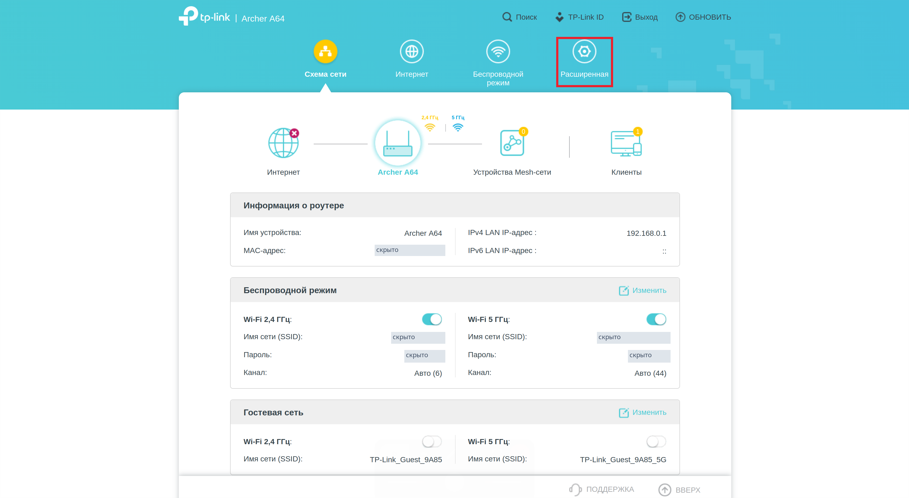

### Шаг 2. Откройте раздел Wi-Fi

Нажмите «Беспроводной режим» слева.

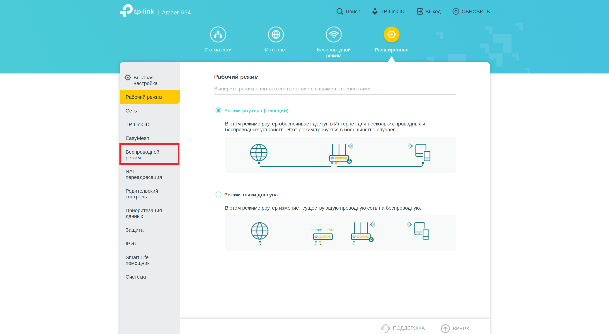

### Шаг 3. Перейдите к параметрам сети

Нажмите «Настройки беспроводного режима» в раскрытом меню.

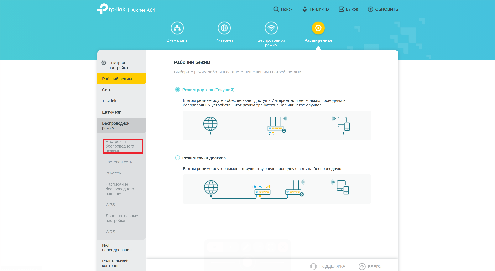

### Шаг 4. Найдите протокол и пароль

В поле «Защита» откройте список протоколов. Поле «Пароль» находится прямо под ним.

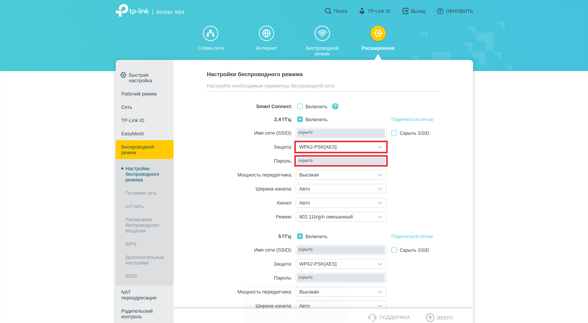

### Шаг 5. Выберите WPA3

В открытом списке нажмите **WPA3-Personal**. Введиье новый пароль в окно ниже

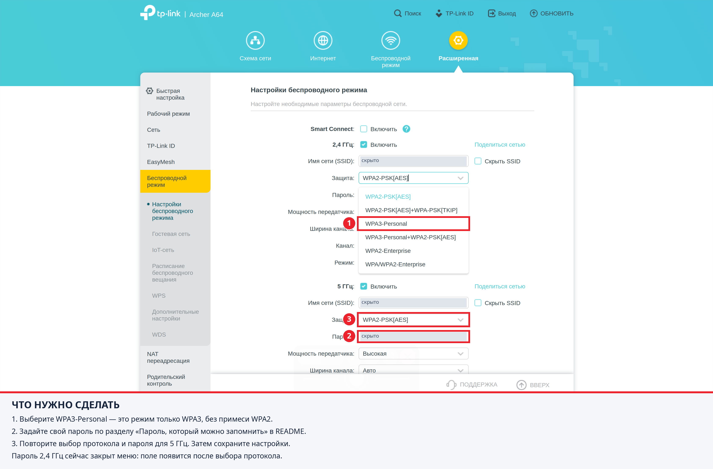

После сохранения подключитесь заново.

[К содержанию](#содержание)

<a id="keenetic"></a>
## Keenetic Start

### Шаг 1. Раскройте боковое меню

Разверните боковое меню через кнопку внизу слева. Значок Wi-Fi указывает нужный раздел.

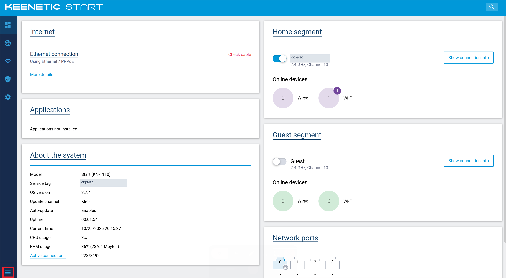

### Шаг 2. Откройте раздел домашней сети

Нажмите **My networks and Wi-Fi**.

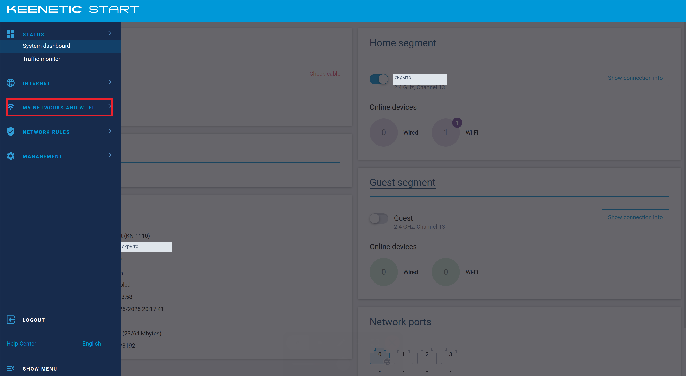

### Шаг 3. Выберите домашний сегмент

Нажмите **Home segment**.

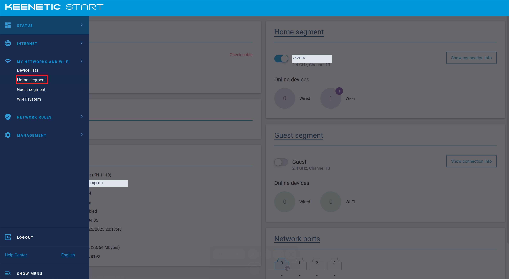

### Шаг 4. Настройте защиту и пароль


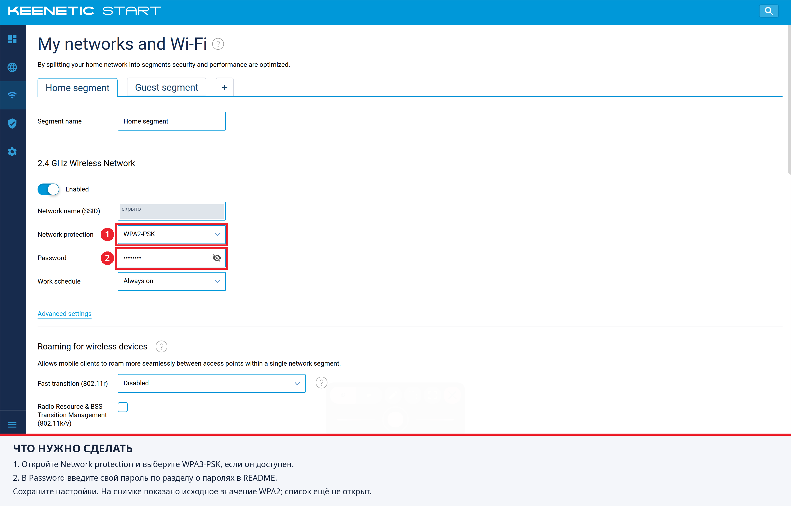

[К содержанию](#содержание)

<a id="routerich"></a>
## RouteRich / Routerich AX3000

### Шаг 1. Откройте сетевые настройки

Нажмите **Network** слева.

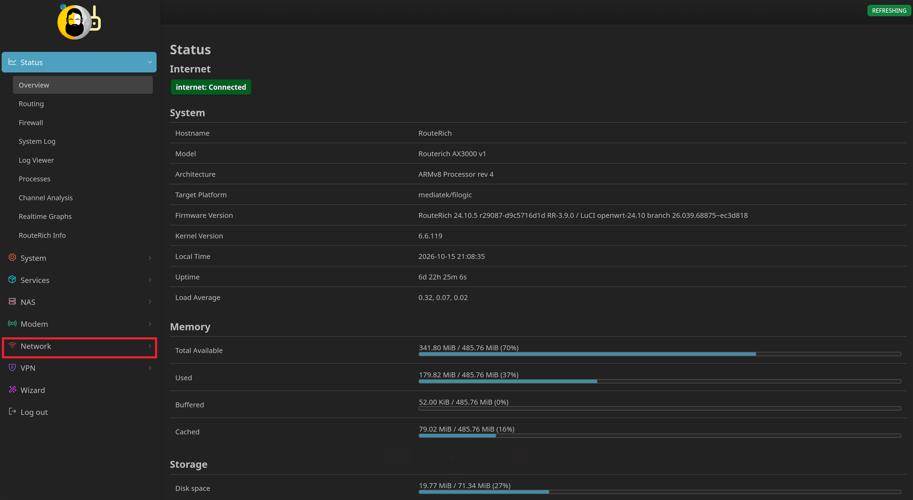

### Шаг 2. Откройте список беспроводных сетей

В раскрытом меню нажмите **Wireless**.

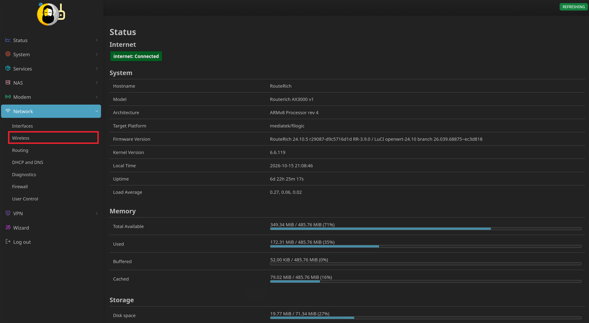

### Шаг 3. Выберите сеть для изменения

Нажмите **Edit** у нужной сети. На примере отмечена первая сеть диапазона 2,4 ГГц.

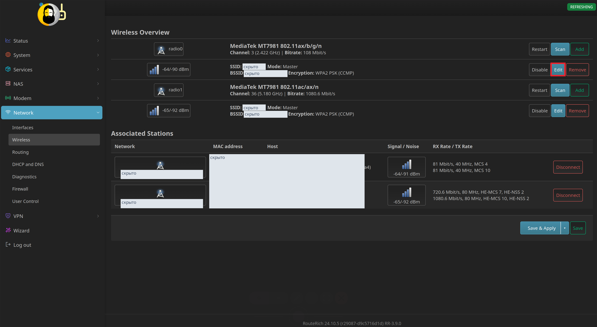

### Шаг 4. Перейдите к защите сети

В окне редактирования откройте вкладку **Wireless Security**.

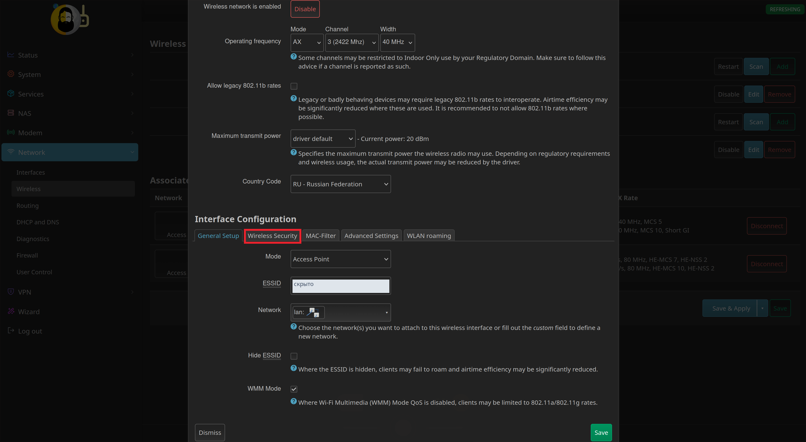

### Шаг 5. Задайте параметры безопасности

Следуйте номерам на снимке.

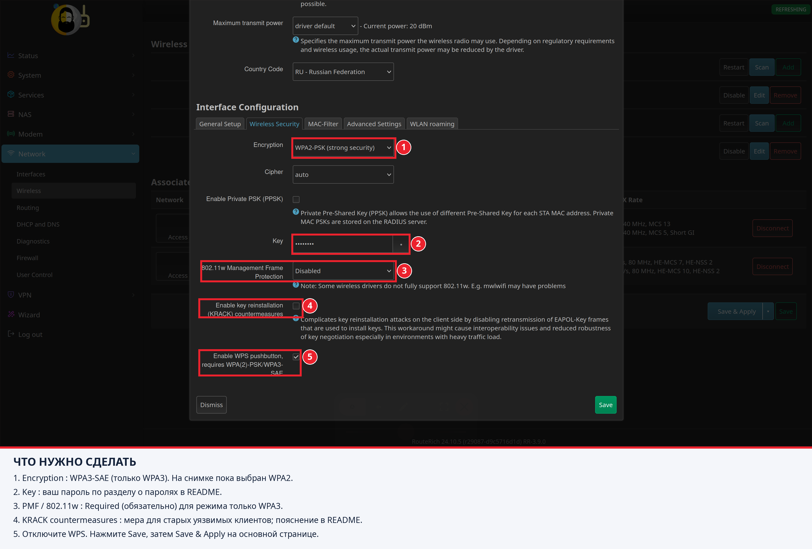

Повторите настройку для сети 5 ГГц и остальных используемых сетей, если есть.

**О KRACK.** На обновлённых устройствах KRACK не сработает и без этой галочки, так как уязвимость была закрыта обновлением WPA2. Эту опцию в OpenWrt стоит использовать, если по какой-то причине вы не можете обновить роутер и клиент до последней версии WPA2

[К содержанию](#содержание)

<a id="password-guide"></a>
## Пароль, который можно запомнить

Хороший пароль Wi-Fi не обязан выглядеть как случайный набор знаков, который невозможно продиктовать. Удобный вариант — **длинная фраза из случайно выбранных слов**. Она должна быть уникальной для этой сети: пароль от почты, игр или панели управления роутером сюда не подходит.

### Основной способ: слова и картинка в голове

1. Получите **шесть независимо выбранных случайных слов** через генератор парольных фраз в менеджере паролей. Самостоятельно придуманная фраза обычно предсказуемее случайного набора.
2. После выбора слов придумайте к ним ассоциации, так будет легче вспомнить фразу даже без менеджера паролей.
3. Для удобства ввода пароля используйте латиницу и разделитель, например дефис. Это вопрос совместимости, а не дополнительная защита.

**Пример парольной фразы. Эту фразу использовать нельзя, так как она доступна в интеренете и, возможно, попадёт в словари паролей**

`limon-parus-kaktus-teatr-vagon-oblako`


### Что делает пароль надёжным

| Полезно | Почему |
| --- | --- |
| Длина: хотя бы 16 символов. Лучше длиннее, чем случайнее | Пароль из n+1 символов перебирать дольше пароля из n символов примерно в 40 раз (26 букв латиницы + 10 цифр + спец символы) |
| Случайный выбор слов | Известные цитаты или строки из песен и книг давно есть в словарях паролей |
| Отдельный пароль для Wi-Fi | Утечка другого аккаунта не должна открывать вашу сеть. |
| Менеджер паролей | Не приходится запоминать все секреты и сокращать их ради удобства, жертвуя безопасностью. |

Замены вроде `a → @`, год рождения, 1 или 2 спец символа в конце могут немного задержать злоумышленника, но не должны являтся основой безопасности пароля.


**Пароль Wi-Fi и пароль администратора - разные секреты.** Первый позволяет подключиться к сети, второй - менять настройки роутера. Для панели управления нужен отдельный уникальный пароль.

[К содержанию](#содержание)

<a id="check"></a>
## Проверка результата и решение проблем

После сохранения настроек:

- [ ] Снова откройте настройки и убедитесь, что выбран режим только WPA3.
- [ ] Проверьте каждый используемый диапазон и отдельную сеть: изменение 2,4 ГГц не обязательно меняет 5 ГГц.
- [ ] Подключите телефон и компьютер с новым паролем; проверьте интернет и нужные домашние устройства.
- [ ] В настройках клиента (телефона) убедитесь, что действительно используется WPA3.

Если клиент не поддерживает WPA3, рассмотрите обновление или отдельную изолированную сеть WPA2-AES для таких клиентов. Смешанный режим WPA2/WPA3 - компромисс совместимости, WPA2 устройство в сети - слабое звено.

**Нет нужного пункта меню?** Проверьте модель, аппаратную ревизию, версию прошивки и документацию производителя. Эта инструкция показывает маршрут по конкретным интерфейсам и не подтверждает поддержку каждой функции на любом роутере той же марки.

<a id="files"></a>
## Где что находится

```text
README.md                 - вся инструкция, цепочки скриншотов и руководство по паролям
screenshots/tp-link/       - 5 пронумерованных изображений TP-Link
screenshots/keenetic/      - 4 пронумерованных изображения Keenetic
screenshots/routerich/     - 5 пронумерованных изображений RouteRich
```

Файлы идут в порядке действий; последние кадры содержат пояснения прямо на изображении. Чтобы рассмотреть детали, нажмите на картинку и откройте её в полном размере. Все пути к картинкам относительные, поэтому README работает и на GitHub, и в локальной копии репозитория.

Интерфейсы и товарные знаки принадлежат соответствующим правообладателям; проект не является официальной инструкцией производителей. Ошибку в маршруте или отличие вашей версии интерфейса можно описать в Issues, указав модель и прошивку. Перед прикреплением нового скриншота закройте пароли и идентификаторы устройств.

[К содержанию](#содержание)
